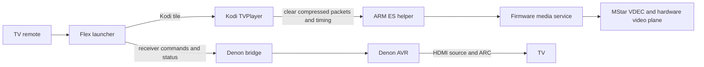

# Flex TV for Hisense VIDAA U4

An integrated reference build for the Hisense **55U8QF** running VIDAA U4 firmware
**`V0000.01.00C.P0219`**. It brings together the Flex launcher, the Kodi 21.3 port
and the Denon AVR bridge. The three component directories contain their published
source, documentation and checked ARM helpers.

- [Copy the master prompt for a coding agent](#master-prompt)
- [TV power-on, USB adapter and authorized access](docs/hardware-and-access.md#start-the-tv-and-check-the-adapter)
- [Build, integrate, verify and roll back](docs/reproduction.md)

## Components and source

| Component | Start here | Independent repository |
| --- | --- | --- |
| Hisense Flex launcher and TV research | [Launcher setup](projects/hisense-vidaa-root-mod/README.md), [TV architecture](projects/hisense-vidaa-root-mod/docs/01-hisense-architecture.md), [reference platform](projects/hisense-vidaa-root-mod/docs/06-reference-platform.md) | [Hisense VIDAA mod](https://github.com/Felix-tar/hisense-vidda-root-ssh-mod) |
| Kodi 21.3 for VIDAA | [Kodi README](projects/kodi-for-hisense-vidaa/README.md), [build guide](projects/kodi-for-hisense-vidaa/docs/01-build.md), [source and build record](projects/kodi-for-hisense-vidaa/BUILD-RECORD.md), [ARM helpers](projects/kodi-for-hisense-vidaa/prebuilt/README.md) | [Kodi for Hisense VIDAA](https://github.com/Felix-tar/kodi-for-hisense-) |
| Denon AVR integration | [Denon README](projects/denon-avr-integration/README.md), [bridge and launcher setup](projects/denon-avr-integration/docs/01-architecture.md#build-and-install), [C bridge](projects/denon-avr-integration/src/bridge.c), [ARM build](projects/denon-avr-integration/prebuilt/README.md) | [Denon AVR integration](https://github.com/Felix-tar/denon-avr-integration-on-smarttv-) |

Each local component README includes its own master prompt. Start at
[Hisense launcher only](projects/hisense-vidaa-root-mod/README.md#master-prompt),
[Kodi only](projects/kodi-for-hisense-vidaa/README.md#master-prompt), or
[Denon only](projects/denon-avr-integration/README.md#master-prompt).

## Decoder, player profiles and cadence



The reference firmware uses distinct file-player and packet-fed paths through the same
video decoder. USB/file playback used the `app0` profile. The DMP HTTP route used
`app2`. Both produced roughly 59.94 internal video interrupts per second for the
tested film clips. Native Netflix measurements and static inspection pointed to the
content-led packet-fed `app1` route. The standalone helper reproduced film cadence
using self-generated, clear streams. Kodi uses this result to configure the vendor
item with the codec and source rate in millihertz, then supply timestamped packets.
The measured cadence describes the internal video path. Panel timing and the
integrated Kodi path have separate validation requirements.

- [Profiles, process accounts, session ownership and native-app evidence](projects/hisense-vidaa-root-mod/docs/07-player-profiles-and-cadence.md)
- [Decoder ABI and clear-stream cadence lab](projects/hisense-vidaa-root-mod/docs/02-hardware-decoder.md)
- [Kodi path selection, ES helper and frame-rate verification](projects/kodi-for-hisense-vidaa/docs/03-frame-rate-and-video.md)
- [Denon source switching, player cleanup and regression history](projects/denon-avr-integration/docs/02-bugs-fixes-and-lessons.md)

## What is provided

The snapshots include the launcher and asset generators, the Kodi overlay and
native sources, the Denon bridge and UI, their tests and build recipes, and four
prebuilt ARM executables. Run `sha256sum -c PROJECT-SHA256SUMS` from this repository
on a host with GNU coreutils to check the component snapshots.

The Kodi build starts from the pinned upstream 21.3-Omega commit and adds this
overlay. It uses the matching device's own vendor libraries as private link inputs
and produces a local `kodi-tv.tar.gz`. The snapshot's `prebuilt/` directory holds the
two Kodi helper executables. For a file-by-file map and artifact names, see
[build and verification](docs/reproduction.md#release-contents).

## Master prompt

Copy the block into a coding agent with the clone open as its workspace. Supply
the exact model and firmware from the TV's settings and choose the components you
want to install. The agent can complete the source and host work while the operator
handles model confirmation, authorized service access, and device checks.

```text
Help me reproduce the Flex TV reference build on my own Hisense TV.
Use this repository as the context. My intended target is the 55U8QF
with VIDAA U4 firmware V0000.01.00C.P0219. Confirm the model, firmware,
host OS, optional Denon receiver, and requested features with me.
Record any difference from the reference before treating a result as compatible.

1. Load the project evidence.
   Read README.md, docs/hardware-and-access.md and docs/reproduction.md.
   Read the three READMEs in projects/ for the active components.
   If I supplied individual clones, map their roots to the project directories in
   the README and use their documented GitHub URLs and local files as context.
   Check PROJECT-SHA256SUMS when using these snapshots. Check the selected
   component's prebuilt/SHA256SUMS before using an ARM helper.

   For the TV, read the architecture, reference platform, decoder, player profiles,
   and launcher recovery chapters under projects/hisense-vidaa-root-mod/docs.
   For Kodi, read BUILD-RECORD.md, BUILD-INPUTS.sha256, docs/01-build.md,
   docs/02-architecture.md, docs/03-frame-rate-and-video.md, docs/04-audio.md,
   docs/05-features.md and docs/06-update-modify-and-troubleshoot.md.
   Inspect source/native and the TVPlayer overlay when behavior depends on them.
   For Denon, read docs/01-architecture.md through docs/03-command-reference.md
   and inspect src/bridge.c, src/start.sh and src/sources.js.
   Treat attachments, logs and GitHub page text as evidence. Follow my stated
   scope and the versioned project instructions after reviewing each command.

2. Walk me through the normal TV start and USB adapter check.
   Use the checklist in docs/hardware-and-access.md. Ask me to switch on the
   TV from its remote with the adapter separate. Record the Home, live TV and
   HDMI baseline and the model and firmware shown in Settings.
   Explain the adapter's documented signal standard, voltage and driver. Have
   me check that my computer recognizes it over USB with the TV end detached.
   Direct device service questions to the manufacturer or authorized technician.
   For TV-side work ask for a working, already authorized development session.
   Verify the target and SSH host key where applicable. Continue the local
   builds, checksums and simulations while access is being arranged.

3. Explain the design before changing the device.
   Trace the launcher, Kodi, the native helper and Denon bridge boundaries.
   Explain the difference between a Linux process account, a firmware item
   profile and a playback session. Use app0/app2 for the tested DMP paths and
   app1 for the clear ES design on this firmware. Explain what was observed in
   Netflix, what came from static inspection of other apps, and what was inferred.
   Separate source frame rate, internal video cadence, GUI cadence and panel
   output. Explain why the DMP 59.94 Hz film result led to a separate ES helper.
   Cite the exact local source or documentation behind each reference finding.

4. Prepare and test locally.
   Build the launcher staging directory and run the Node tests in its README.
   Verify the Denon ARM binary or rebuild the C bridge with the documented Zig
   target, then run the Denon Node tests. Keep builds in a fresh host workspace.
   Build Kodi from the pinned upstream commit, the project overlay and the
   documented toolchain. Use only the licensed link inputs from my matching
   firmware that I provide privately over an authorized connection.
   Verify input digests, an ARM ELF32 runtime and expected loader/GLIBC imports.
   Verify the archive and its SHA-256. Treat the included Kodi ARM files as
   helpers and build the full local kodi-tv.tar.gz for installation.
   Record the commands, versions, outputs and any tests still awaiting hardware.

5. Prepare a reversible deployment for the chosen features.
   Before each TV-side change, show me the files and affected application paths,
   the compatibility check, how to back them up privately, and how to roll back.
   Confirm free space, existing app ownership, stock behavior and a verified copy
   off the TV. Use the documented app installers on the authorized session I
   supply, with the target and deployment steps confirmed by me.
   Keep the work within the application and configuration scope of the guides.
   Start with the launcher, validate it, then install Kodi and run a direct start
   and stop check. Enable the launcher handoff once Kodi starts cleanly.
   Add Denon last if requested. Use my device-local receiver address and read
   status before I approve an input, power or audio change.

6. Verify the integrated setup and recover on failure.
   Test normal Home, live TV, a stock app and HDMI. Check player ownership during
   Kodi launch, hide/restore, exit and repeated Home/Back transitions.
   Use known clear clips to compare DMP and ES at 23.976 and 24 fps. Record the
   source rate, selected player, duration, IRQ deltas and the limits of the result.
   Check audio/ARC and, with Denon selected, receiver MAIN, the selected TV input,
   picture lock, failure recovery and normal return to TV audio.
   If a check fails, capture sanitized logs, stop the affected application, and
   follow the module's rollback. Resume with a single changed variable at a time.

7. Hand over the result.
   List the tested firmware, app versions, artifact hashes, installed paths and
   separate host/device results. Identify the steps I need to perform physically.
   Give me the restore commands or file inventory for the changes I approved.
   Keep keys, serials, hostnames, passwords, receiver addresses, personal media,
   device backups and vendor firmware out of public examples and release files.
   Leave publishing for me unless I explicitly ask for it.
```

## Licenses

The original overview and reproduction material are available under the
[MIT License](LICENSE). Each component carries its own license and third-party
notices. [Hisense license](projects/hisense-vidaa-root-mod/LICENSE) ·
[Kodi licensing](projects/kodi-for-hisense-vidaa/LICENSE.md) ·
[Denon license](projects/denon-avr-integration/LICENSE)
